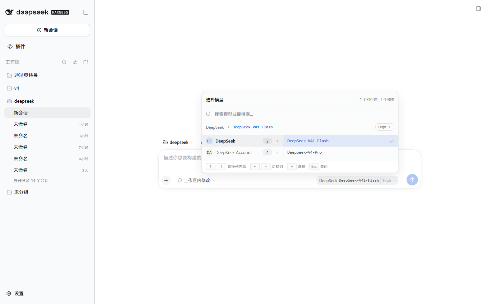
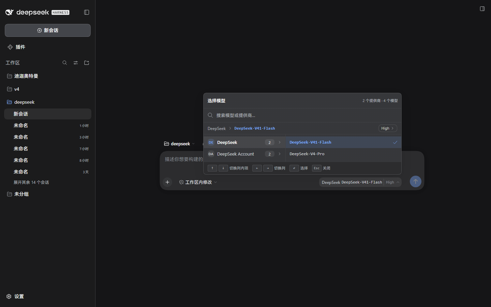

# dsh-cascade-model-picker

给 **DeepSeek Harness** 的**级联模型选择器**：把 composer 上原来的「Model → Effort 两级下钻菜单」换成带搜索的 **provider × model 双列面板**。

<p align="center">
  
</p>
<p align="center">
  
</p>

## 特性

- 替换 composer 的 `conversation.input.model` 座位，同时接管 `/model` 命令的弹层（两者共用同一份会话目录状态）。
- 面板结构：标题 +「N 个提供商 · M 个模型」计数、搜索框（模型名与提供商名一起过滤并高亮）、当前路由面包屑、左列提供商（240px）+ 右列模型、底部快捷键提示。
- effort（推理档位）仍在面包屑末尾的 caption 条里单列下钻，选完即关。
- **选择模型或 effort 后面板立即关闭**；点提供商只切换右列、不关闭；选择被 Host 拒绝时通过共享 Toast 报错，不再静默停留。
- 无障碍：真实可聚焦的 `option` / `listbox` / `dialog`，`↑`/`↓` 列内移动、`←`/`→` 跨列、`Enter` 选择、`Esc` 逐层退出（先清搜索词、再退 effort、最后关闭）。
- 样式全部走 `--dsw-*` 设计变量，浅色 / 深色跟随 DSH 主题，面板不透明。

## 环境要求

- 已在 **DSH 桌面端 0.2.0-rc.2** 上验证。面板使用 0.2.x 的图标导出名（`IconXxxOutlineRegular` 系列）；0.1.x 的 `IconXxxOutline16` / `...14` 命名会让整条 slot 崩溃（React error #130），座位会直接消失。
- 需要 shell 提供这些模块表条目：`react`、`react/jsx-runtime`、`@deepseek-ai/cordis`、`@deepseek-ai/dsh-client-store`、`@deepseek-ai/dsh-client-ui-primitives`。

## 安装

### 桌面端（推荐：插件市场）

设置 → 插件市场 → GitHub，填仓库名 `<你的用户名>/dsh-cascade-model-picker`。

> 桌面端的 `desktop` profile 由 Electron App 独占管理，`dsh plugin --profile desktop add …` 会被拒绝：
> `error: profile "desktop" is managed exclusively by the Electron application`。请走 App 内的插件市场。

### 其他 profile（CLI）

```bash
dsh plugin --profile <profile> add github:<你的用户名>/dsh-cascade-model-picker
```

客户端包只在**启动时**载入：装完刷新页面，桌面端需要完全退出后重启。

## 它怎么接进去的

composer 的模型座位属于内置组合包 `@deepseek-ai/dsh-web-app` 声明的那一行：

```yaml
- id: ui-model-selection
  name: '@deepseek-ai/dsh-client-ui-model-selection'
```

补丁层**不能改一行的 `name`**：Loader 会把补丁里的 name 与已声明的 name 比对，不一致就整条丢弃
（`patch: name mismatch for "ui-model-selection" (expected …), skipping`）。因此本插件用自己的
`dsh.bundle.patch`（[`cordis.patch.yml`](cordis.patch.yml)）做两件受支持的事：

1. `insert` 一行 `cascade-model-selection`，指向本包 —— 由本包的 client 半边注册**同一个座位名**；
2. 按 `id` 重述内置行（`name` 必须原样重复）并 `disabled: true`，把内置菜单从客户端模块表里摘掉，
   避免两个组件同时抢一个座位。

```yaml
- insert:
    - id: cascade-model-selection
      name: 'dsh-cascade-model-picker'
- id: ui-model-selection
  name: '@deepseek-ai/dsh-client-ui-model-selection'
  disabled: true
```

> 写补丁时的两个坑：`insert:` 是**加行**，裸行是**覆盖既有行**（覆盖不存在的 id 会报
> `patch: entry "…" not found`）；覆盖时必须重述该行需要的每一个键，而不是只写改动的那个。

## 从源码构建

```bash
pnpm install
pnpm run bundle     # tsdown → lib/index.js, lib/invariant.js, lib/client.js
```

构建产物 `lib/` 已随仓库提交，所以直接以 GitHub 源安装不需要本地构建。

## 卸载

插件市场卸载，或 `dsh plugin --profile <profile> remove dsh-cascade-model-picker`，重启后恢复内置菜单。

## 许可

[MIT](LICENSE)
